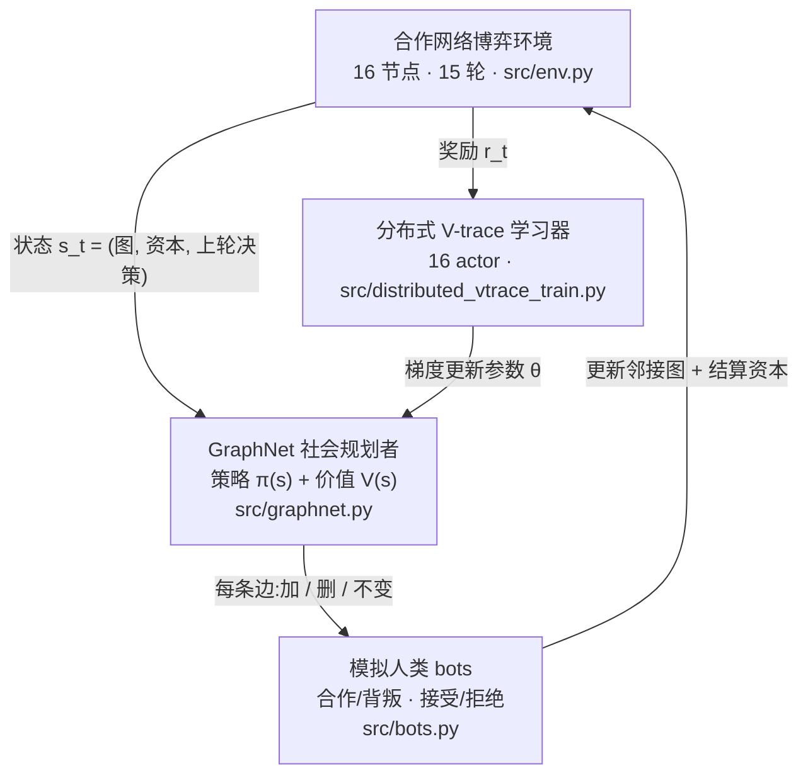
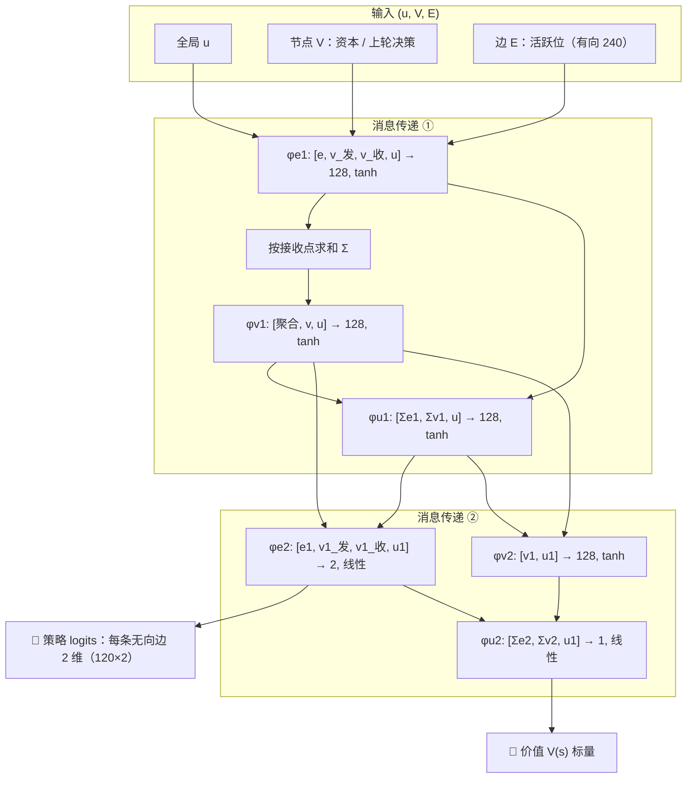

# GraphNet 社会规划者 · 论文机制复现(成功版)

> **复现论文**:McKee et al. 2023, *Scaffolding cooperation in human groups with deep reinforcement learning*, **Nature Human Behaviour**.
> DOI: [10.1038/s41562-023-01686-7](https://doi.org/10.1038/s41562-023-01686-7) · OSF: <https://osf.io/8ahkg/>

用 **图神经网络(GraphNet)+ 深度强化学习** 从零训练一个「社会规划者」,在 16 人合作网络博弈中通过 **推荐建立/断开人际连边** 促进群体合作。本仓库是该论文 **非人类计算部分** 的 from-scratch 复现(纯 Python + PyTorch,不依赖 `torch_geometric`,不用 OSF 脚本)。

> ✅ **本版本已成功复现论文的核心机制**:在 `paper_minimal + target_state + 分布式 V-trace` 配方下,规划者学会了论文最标志性的策略——**几乎总是断开「背叛者-背叛者」连边**,并将群体合作率提升到 **≈0.78**,与论文一致。详见下节与 [`docs/MECHANISM_VALIDATION.zh-CN.md`](docs/MECHANISM_VALIDATION.zh-CN.md)。

---

## 目录
1. [✅ 机制复现结果](#1--机制复现结果核心)
2. [复现范围](#2-复现范围)
3. [系统总览](#3-系统总览)
4. [GraphNet 网络架构](#4-graphnet-网络架构)
5. [A2C + V-trace 训练](#5-a2c--v-trace-训练)
6. [成功配方 & 为什么它有效](#6-成功配方--为什么它有效)
7. [快速开始](#7-快速开始)
8. [仓库结构](#8-仓库结构)
9. [诚实边界](#9-诚实边界)

---

## 1. ✅ 机制复现结果(核心)

**单 seed(42)、1,000,005 轮、分布式 V-trace** 训练后,最终 checkpoint 的 Table 6 风格策略审计:

| 边类型 | 动作 | **本复现** | **论文** | 方向 |
|---|---|---:|---:|:--:|
| C-C(合作-合作) | add | 0.821 | 0.994 | ✅ |
| C-C | delete | 0.177 | 0.030 | ✅ |
| C-D(合作-背叛) | add | 0.319 | 0.582 | ✅ |
| C-D | delete | **0.988** | 0.503 | ✅ |
| D-D(背叛-背叛) | add | **0.0007** | 0.000 | ✅ |
| **D-D** | **delete** | **1.0000** | **1.000** | ✅ |

**合作水平**:mean cooperation **0.782**、末轮合作 **0.779**(论文 0.777);Gini 0.040(高度均等);末轮网络密度 0.635(非全连通)。

**训练收敛曲线**(策略从"先连满全图"逐步学出"选择性断 D-D"):

```
   轮数       D-D delete   网络密度   末轮合作
   10,005       0.000       0.9999     0.642    ← 早期:连满全图
  250,125       0.725       0.5111     0.696    ← 机制涌现中
  570,285       1.000       0.5391     0.748
1,000,005       1.000       0.6353     0.779    ← 最终:对齐论文 ✅
```

> 关键含义:论文发现「规划者对背叛者采取**安抚+保护**策略——不惩罚排斥,而是断开背叛者之间的连边、把他们推入小型高合作邻域」。本复现在纯 bot 仿真中**自发学出了同一机制**。

---

## 2. 复现范围

| | 内容 |
|---|---|
| ✅ 复现 | 合作网络博弈环境 · 模拟人类 bots · 6 种规则 planner · GraphNet planner · A2C · **分布式 V-trace** · 评估 · Table 6 策略审计 · 结构化日志 · 测试 |
| ❌ 不复现 | Prolific 招募 · 浏览器 UI · 知情同意/支付/问卷 · OCR · 出版级配图 |

---

## 3. 系统总览

强化学习闭环:环境产生状态 → GraphNet 给出每边推荐 → 模拟人类 bots 接受/拒绝并选择合作/背叛 → 环境更新图与资本、返回奖励 → V-trace 学习器更新网络参数。



**博弈参数(与论文 Supplement Table 1 逐项一致)**:16 玩家、15 轮、ER 初始 p=0.3、初始资本 1.0、合作收益 b=0.1、成本 c=0.05。
每轮:① bots 决策合作/背叛 → ② 结算收益 `payoff = b·合作邻居 − c·action·degree` → ③(非末轮)规划者推荐 → ④ bots 按接受概率裁决 → ⑤ 更新图 + 奖励 `r = mean(capital) − P·(被拒推荐/边数)`。**末轮不发推荐**(与论文一致)。

---

## 4. GraphNet 网络架构

严格按论文 **Supplement E1 + Table 4 + Fig.1c** 搭建:**2 个消息传递步、6 个单层 MLP、非递归**。



**与 Supplement Table 4 逐项对照(全部一致)**:输出尺寸 128/128/128/**2**/128/**1**,激活 tanh/tanh/tanh/-/tanh/-,截断正态初始化 `σ=1/√fan-in`、±2σ。`φv²` 输入排除更新后边属性(与论文一致)。策略取自更新后边属性 `E'`(每边 2 logit → 目标边状态),价值取自更新后全局属性 `u'`。

---

## 5. A2C + V-trace 训练

- **策略采样**:每条边独立 `Categorical(2)` 采样目标边状态,映射为 加/删/不变;整局联合 `logπ` 与熵为各边之和。
- **A2C 损失(Supplement E2)**:`loss = policy_gradient + 0.5·baseline_L2 − 0.004·entropy`(`src/a2c.py`)。
- **V-trace(Supplement E2,Espeholt 2018/IMPALA)**:异步 actor-learner 的重要性采样修正(`src/vtrace.py`),支撑分布式训练(`src/distributed_vtrace_train.py`)。

**训练超参(与 Supplement Table 5 逐项一致)**:

| 参数 | 值 | | 参数 | 值 |
|---|---|---|---|---|
| batch size | 32 | | 学习率 | 4e-4 |
| 折扣 γ | 0.99 | | 惩罚权重 P | 1.0 |
| 熵正则 | 0.004 | | baseline cost | 0.5 |
| 优化器 | Adam | | 梯度裁剪 | 10.0 |

---

## 6. 成功配方 & 为什么它有效

**成功配方**(本版本的主线):

| 项 | 值 |
|---|---|
| action semantics | `target_state` |
| feature mode | **`paper_minimal`** |
| 算法 | **`distributed_actor_learner_vtrace`**(16 actor) |
| seed | 42 |
| 训练规模 | 1,000,000 轮 |

**为什么这个配方成功、而"augmented 特征 + 单进程 A2C"会失败**(经对照实验确认):

1. **`paper_minimal` 是关键**:论文的最小观测只有「资本、上轮决策、边活跃位」。若额外把「度数/密度/轮次」直接喂给网络(`augmented`),策略会走捷径直接最大化密度 → **塌缩成全连通**,学不出选择性断边。只给最小观测,网络才**被迫**学出论文的结构策略。
2. **分布式 V-trace 是第二关键**:16 个 actor 的多样经验 + off-policy 修正,帮助策略**跳出**单进程 A2C 会陷入的"全连通"局部最优(收敛曲线的振荡→收敛正是这一过程)。

> 对照(失败配方,默认 seed + augmented + 单进程 A2C):D-D delete ≈ 0.013、合作 ≈ 0.649——机制未涌现。可见 **忠实于论文的最小观测,是复现成功的前提**。

---

## 7. 快速开始

```bash
# 1) 安装
python -m pip install -e .          # Python 3.10+;主要依赖 PyTorch/NumPy/pandas/NetworkX/...

# 2) 测试(机制/单元测试)
python -m pytest                    # 参考:mechanism/unit smoke 60 passed
python -m compileall -q src scripts tests   # 快速语法检查

# 3) 分布式 V-trace 冒烟(CPU,秒级)
python -m src.distributed_vtrace_train \
  --root smoke_outputs/vtrace_tiny --rounds 60 --seed 42 --device cpu \
  --batch-size 2 --num-actors 2 --actor-torch-threads 1 \
  --checkpoint-interval-rounds 30 \
  --action-semantics target_state --feature-mode paper_minimal
```

**论文对齐训练(服务器,复现上文结果的配方)**:

```bash
TRAIN_GPU=0 EVAL_GPU=1 NUM_ACTORS=16 TARGET_ROUNDS=1000000 SEED=42 \
FEATURE_MODE=paper_minimal ACTION_SEMANTICS=target_state \
bash scripts/run_distributed_vtrace_seed42.sh
```

**50M 论文规模续训**(从 checkpoint 继续,逼近论文 30×50M 的单副本):

```bash
RESUME_CHECKPOINT=/path/to/latest.pt TARGET_ROUNDS=50000000 \
TRAIN_GPU=0 EVAL_GPU=1 bash scripts/run_distributed_vtrace_resume.sh
```

**评估**:`bash scripts/run_eval.sh`(= `python -m src.evaluate --root . --n-eval-episodes 16 --checkpoint <ckpt>`),产出 Table 6 策略审计与合作率。

---

## 8. 仓库结构

```text
src/          核心实现(env / bots / planners / graphnet / a2c / vtrace /
              train / distributed_vtrace_train / evaluate / metrics / 各类诊断审计)
scripts/      训练 / 评估 / 诊断 / checkpoint 审计脚本
tests/        机制与冒烟测试(25 个测试文件)
docs/         机制核验摘要(MECHANISM_VALIDATION.zh-CN.md)
paper_inputs/ 论文输入占位(实际 PDF/markdown 已 gitignore,避免版权分发)
pyproject.toml 打包与依赖(pip install -e .)
```

> Python 包名即 `src`(入口 `python -m src.<module>`);所有配置集中在 [`src/config.py`](src/config.py)。

---

## 9. 诚实边界

本仓库是 **研究工程复现**,不等于论文的完整统计复现。可以说 / 不应说:

**可以说** ✅
- 工程训练链路真实跑通,checkpoint/评估/Table 6 审计链路可用;
- 单 seed 42、1M 轮的最终 checkpoint **通过了机制对齐门槛**,方向与合作率对齐论文。

**不应说** ❌
- 已复现论文全部计算结果 / 30 replicate 统计体系;
- Table 6 数值等价于**人类被试** GraphNet 条件(此处为 **bot 仿真**);
- 单 seed pilot 可替代完整统计复现。

要成为论文级复现,后续需:多种子 × 5×10⁷ 轮(用 `run_distributed_vtrace_resume.sh`)、并用论文的 bimodular surprise 指标替换 core-periphery 近似。详见 [`docs/MECHANISM_VALIDATION.zh-CN.md`](docs/MECHANISM_VALIDATION.zh-CN.md)。
